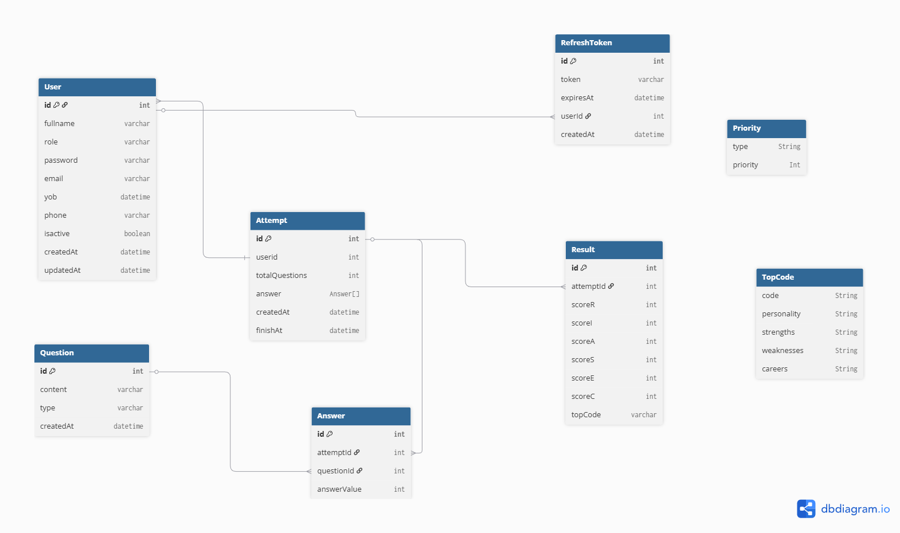

# DB Schema Documentation

## DB Schema: Demo (chưa đụng tới User)

> Phiên bản demo ban đầu, hệ thống chưa liên kết với User.  
> Mỗi Attempt đại diện cho một phiên làm bài độc lập.

### Schema Diagram (Demo)

---

---

## DB Context

Hệ thống được xây dựng xoay quanh việc người dùng làm bài trắc nghiệm định hướng nghề nghiệp
theo mô hình **RIASEC (R / I / A / S / E / C)**.

---

## Relationships

### Attempt – Answer (1-N)

- **1 Attempt** có thể có **nhiều Answer**
- Mỗi Answer đại diện cho một câu hỏi đã được trả lời trong phiên làm bài

### Answer – Question (1-1)

- **1 Answer** tương ứng với **1 Question**
- `answerValue` là kết quả người dùng chọn cho câu hỏi đó

### Attempt – Result (1-1)

- **1 Attempt** chỉ có **1 Result**
- Result là kết quả tổng hợp sau khi kết thúc phiên làm bài

---

## Entities

### Question

- `id`: Khóa chính
- `content`: Nội dung câu hỏi
- `type`: Thể loại câu hỏi theo mô hình **R / I / A / S / E / C**

---

### Attempt

- `userId`:
  - Khóa ngoại liên kết với User
  - Dùng để xác định phiên làm bài thuộc về người dùng nào
- `totalQuestions`:
  - Tổng số câu hỏi trong phiên làm bài
- `answers`:
  - Danh sách các Answer của phiên
  - Được lưu sau khi người dùng hoàn thành bài
- `createdAt`:
  - Thời điểm bắt đầu phiên làm bài
- `finishAt`:
  - Thời điểm kết thúc phiên làm bài

---

### Answer

- `attemptId`:
  - Xác định Answer thuộc về Attempt nào
- `questionId`:
  - Xác định Answer tương ứng với Question nào
- `answerValue`:
  - Giá trị câu trả lời của người dùng cho câu hỏi đó

---

### Result

- `attemptId`:
  - Liên kết kết quả với Attempt tương ứng
- `scoreR`:
  - Tổng điểm nhóm **Realistic (R)**
- `scoreI`:
  - Tổng điểm nhóm **Investigative (I)**
- `scoreA`:
  - Tổng điểm nhóm **Artistic (A)**
- `scoreS`:
  - Tổng điểm nhóm **Social (S)**
- `scoreE`:
  - Tổng điểm nhóm **Enterprising (E)**
- `scoreC`:
  - Tổng điểm nhóm **Conventional (C)**
- `topCode`:
  - Thể loại (**R / I / A / S / E / C**) có số điểm cao nhất
  - Dùng để xác định nhóm định hướng nghề nghiệp phù hợp nhất

---

### Priority:

- `type` các loại (R/I/A/S/E/C)
- `priority` độ ưu tiên của loại

### TopCode:

- `code`
- RIA/RES/RSC
  `personality`
- tính cách của nhóm trên
  `strenghs`
- Ưu điểm của nhóm trên
  `weaknesses`
- Nhược điểm của nhóm trên
  `careers`
- ngành phù hợp của nhóm trên
